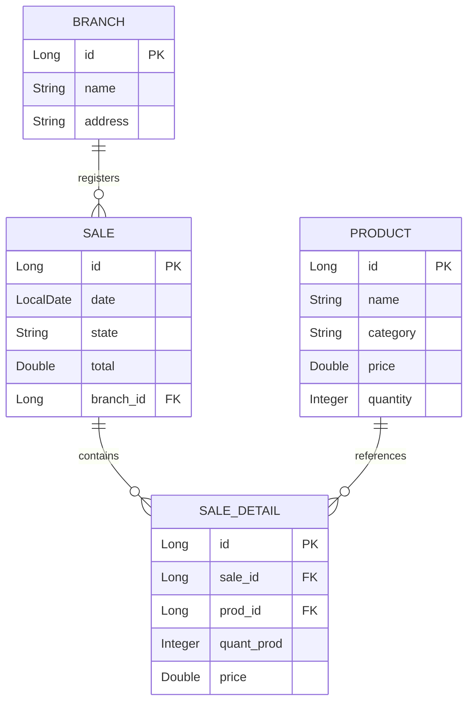

# 🛒 Supermarket API

REST API for managing a supermarket: **products**, **branches**, and **sales** with multiple line items. Built with Spring Boot, Spring Data JPA, and MySQL.


---

## Table of Contents

- [Overview](#overview)
- [Features](#features)
- [Tech Stack](#tech-stack)
- [Architecture](#architecture)
- [Data Model](#data-model)
- [Project Structure](#project-structure)
- [Requirements](#requirements)
- [Configuration](#configuration)
- [Running the Application](#running-the-application)
- [REST API](#rest-api)
  - [Products](#products)
  - [Branches](#branches)
  - [Sales](#sales)

---

## Overview

**Supermarket API** is a REST backend for managing the product catalog, the business branches, and the sales made at each branch.

Each sale is composed of one or more line items (product, quantity, and unit price). The **sale total is calculated on the server** from those line items, so the client cannot submit an arbitrary total when registering a sale.

The project follows a layered architecture that separates the persistence model (JPA entities) from the HTTP contract (DTOs), and uses transactions to guarantee that a sale and all of its line items are saved atomically.

---

## Features

- Full CRUD for **products** and **branches**.
- **Sales** registration with multiple line items.
- **Server-side total** calculation (`price × quantity` per line).
- **Cascading persistence** of sale details (`CascadeType.ALL` + `orphanRemoval`).
- **Transactional** sale creation (`@Transactional`): if one line item fails, nothing is saved.
- Product lookup by name to resolve sale line items.
- Explicit entity → DTO mapping to decouple the API from the database schema.
- Configuration through **environment variables** (`.env`), with no credentials in the repository.

---

## Tech Stack

| Technology | Version | Purpose |
|---|---|---|
| Java | 17 | Language and runtime |
| Spring Boot | 4.1.2 | Base framework |
| Spring Web MVC | — | REST API exposure |
| Spring Data JPA | — | Data access and repositories |
| Hibernate | — | JPA implementation (managed by Spring Boot) |
| MySQL | 8.x | Relational database |
| Lombok | — | Boilerplate reduction (getters, setters, builders) |
| Maven | 3.9+ | Dependency management and build (wrapper included) |

> The versions of Spring Web MVC, Spring Data JPA, Hibernate, and Lombok are managed by the `spring-boot-starter-parent` declared in `pom.xml`.

---

## Architecture

A request flows through the following layers:

```text
┌──────────────────┐
│   HTTP Client    │
└────────┬─────────┘
         │ JSON
         ▼
┌──────────────────┐
│    Controller    │  @RestController · validates the DTO contract
└────────┬─────────┘
         ▼
┌──────────────────┐
│     Service      │  Interface + implementation · business rules and transactions
└────────┬─────────┘
         ▼
┌──────────────────┐
│    Repository    │  Spring Data JPA · queries and persistence
└────────┬─────────┘
         ▼
┌──────────────────┐
│      MySQL       │
└──────────────────┘
```

| Package | Responsibility |
|---|---|
| `controller` | Exposes HTTP endpoints and returns `ResponseEntity`. |
| `service` | Declares contracts (`I*Service`) and implements business logic. |
| `repository` | Spring Data JPA interfaces for each entity. |
| `model` | JPA entities mapped to MySQL tables. |
| `dto` | Transfer objects used by the API (input and output). |
| `mapper` | Explicit conversion from entities to DTOs (`Mapper.toDTO(...)`). |
| `exception` | Domain exceptions (`NotFoundException`). |

---

## Data Model



### Relationships

| Relationship | Cardinality | Configuration |
|---|---|---|
| `Sale` → `Branch` | Many-to-one | `@ManyToOne` (EAGER by default) |
| `Sale` → `SaleDetail` | One-to-many | `@OneToMany(mappedBy = "sale", cascade = ALL, orphanRemoval = true)` |
| `SaleDetail` → `Product` | Many-to-one | `@ManyToOne(fetch = LAZY)` |

> `SaleDetail.price` stores the **unit price at the time of sale**, so a sale keeps its historical value even if the product price changes later.

---

## Project Structure

```text
spring-boot-supermarket-test/
├── pom.xml
├── mvnw / mvnw.cmd              # Maven Wrapper
├── .env                         # Local environment variables (not versioned)
└── src
    ├── main
    │   ├── java/com/test/supermarket
    │   │   ├── SupermarketApplication.java
    │   │   ├── controller
    │   │   │   ├── ProductController.java
    │   │   │   ├── BranchController.java
    │   │   │   └── SaleController.java
    │   │   ├── service
    │   │   │   ├── IProductService.java / ProductService.java
    │   │   │   ├── IBranchService.java  / BranchService.java
    │   │   │   └── ISaleService.java    / SaleService.java
    │   │   ├── repository
    │   │   │   ├── ProductRepository.java
    │   │   │   ├── BranchRepository.java
    │   │   │   └── SaleRepository.java
    │   │   ├── model
    │   │   │   ├── Product.java
    │   │   │   ├── Branch.java
    │   │   │   ├── Sale.java
    │   │   │   └── SaleDetail.java
    │   │   ├── dto
    │   │   │   ├── ProductDTO.java
    │   │   │   ├── BranchDTO.java
    │   │   │   ├── SaleDTO.java
    │   │   │   └── SaleDetailDTO.java
    │   │   ├── mapper
    │   │   │   └── Mapper.java
    │   │   └── exception
    │   │       └── NotFoundException.java
    │   └── resources
    │       └── application.properties
    └── test
        └── java/com/test/supermarket
            └── SupermarketApplicationTests.java
```

---

## Requirements

- **JDK 17** or higher.
- **MySQL 8.x** running.
- **Maven** (optional: the project ships with the `mvnw` / `mvnw.cmd` wrapper).
- A database created for the project.

---

## Configuration

### 1. Create the database

```sql
CREATE DATABASE supermarket_db;
```

> Adjust the name to your preference; it only needs to match `DB_URL`.

### 2. Create the `.env` file

Create a `.env` file at the **project root** (it is already listed in `.gitignore`):

```properties
DB_URL=jdbc:mysql://localhost:3306/supermarket
DB_USER_NAME=root
DB_PASSWORD=your_password
DB_PLATFORM=org.hibernate.dialect.MySQLDialect
```

| Variable | Description |
|---|---|
| `DB_URL` | JDBC connection URL for MySQL. |
| `DB_USER_NAME` | Database user. |
| `DB_PASSWORD` | User password. |
| `DB_PLATFORM` | Hibernate dialect (defaults to `org.hibernate.dialect.MySQLDialect`). |

### 3. How the variables are loaded

`src/main/resources/application.properties` imports the `.env` file and references the variables:

```properties
spring.config.import=optional:file:.env[.properties]

spring.datasource.url=${DB_URL}
spring.datasource.username=${DB_USER_NAME}
spring.datasource.password=${DB_PASSWORD}
spring.jpa.hibernate.ddl-auto=update
spring.jpa.properties.hibernate.dialect=${DB_PLATFORM}

server.port=8080
```

> `ddl-auto=update` creates and updates tables automatically from the entities.

---

## Running the Application

### With the Maven Wrapper

```bash
# Windows (PowerShell / CMD)
.\mvnw.cmd spring-boot:run

# Linux / macOS
./mvnw spring-boot:run
```

The API is then available at `http://localhost:8080`.

### Changing the port

```bash
.\mvnw.cmd spring-boot:run "-Dspring-boot.run.arguments=--server.port=8081"
```

### Packaging and running the JAR

```bash
.\mvnw.cmd clean package
java -jar target/supermarket-0.0.1-SNAPSHOT.jar
```

### From IntelliJ IDEA

1. Open the project as a Maven project.
2. Make sure the project SDK is **Java 17**.
3. Run `SupermarketApplication` (▶ button).
4. Ensure the `.env` file is at the project root, since it is loaded at runtime.

---

## REST API

**Base URL:** `http://localhost:8080/api`

| Method | Endpoint | Description | Response |
|---|---|---|---|
| `GET` | `/api/products` | List all products | `200 OK` |
| `POST` | `/api/products` | Create a product | `201 Created` |
| `PUT` | `/api/products/{id}` | Update a product | `200 OK` |
| `DELETE` | `/api/products/{id}` | Delete a product | `204 No Content` |
| `GET` | `/api/branches` | List all branches | `200 OK` |
| `POST` | `/api/branches` | Create a branch | `201 Created` |
| `PUT` | `/api/branches/{id}` | Update a branch | `200 OK` |
| `DELETE` | `/api/branches/{id}` | Delete a branch | `204 No Content` |
| `GET` | `/api/sales` | List all sales with their details | `200 OK` |
| `POST` | `/api/sales` | Register a sale | `201 Created` |
| `PUT` | `/api/sales/{id}` | Update a sale's general data | `200 OK` |
| `DELETE` | `/api/sales/{id}` | Delete a sale and its details | `204 No Content` |

> Business errors (for example, a nonexistent product or branch) are currently returned as `500 Internal Server Error`.

---

### Products

#### `GET /api/products`

```json
[
  {
    "id": 8,
    "name": "Chocapic",
    "category": "Cereal",
    "price": 9.99,
    "quantity": 40
  },
  {
    "id": 11,
    "name": "Apple",
    "category": "Fruit",
    "price": 1.99,
    "quantity": 120
  }
]
```

#### `POST /api/products`

```json
{
  "name": "Chocapic",
  "category": "Cereal",
  "price": 9.99,
  "quantity": 40
}
```

**Response `201 Created`** (includes the `Location: /api/products/8` header):

```json
{
  "id": 8,
  "name": "Chocapic",
  "category": "Cereal",
  "price": 9.99,
  "quantity": 40
}
```

#### `PUT /api/products/{id}`

```json
{
  "name": "Chocapic Whole Grain",
  "category": "Cereal",
  "price": 10.49,
  "quantity": 35
}
```

Returns `200 OK` with the updated product.

#### `DELETE /api/products/{id}`

Returns `204 No Content`.

---

### Branches

#### `GET /api/branches`

```json
[
  {
    "id": 6,
    "name": "Downtown Branch",
    "address": "123 Main Avenue"
  },
  {
    "id": 7,
    "name": "North Branch",
    "address": "45th Street #12-30"
  }
]
```

#### `POST /api/branches`

```json
{
  "name": "Downtown Branch",
  "address": "123 Main Avenue"
}
```

**Response `201 Created`** with the `Location: /api/branches/6` header and an **empty body**.

> Current controller behavior: unlike products and sales, creating a branch does not return the created resource in the body.

#### `PUT /api/branches/{id}`

```json
{
  "name": "Renovated Downtown Branch",
  "address": "456 Main Avenue"
}
```

Returns `200 OK` with the updated branch.

#### `DELETE /api/branches/{id}`

Returns `204 No Content`.

---

### Sales

A sale is made up of general data (`date`, `state`, `branchId`) and a list of `details`. Each detail references a product **by name** (`nameProd`), specifies the quantity (`quantProd`), and the unit price (`price`).

#### `GET /api/sales`

```json
[
  {
    "id": 10,
    "date": "2026-11-01",
    "state": "REGISTERED",
    "branchId": 7,
    "details": [
      {
        "id": 5,
        "nameProd": "Chocapic",
        "quantProd": 2,
        "price": 9.99,
        "subtotal": 19.98
      },
      {
        "id": 6,
        "nameProd": "Apple",
        "quantProd": 3,
        "price": 1.99,
        "subtotal": 5.97
      }
    ],
    "total": 25.95
  }
]
```

#### `POST /api/sales`

```json
{
  "date": "2026-11-10",
  "state": "REGISTERED",
  "branchId": 6,
  "details": [
    {
      "nameProd": "Chocapic",
      "quantProd": 2,
      "price": 9.99
    },
    {
      "nameProd": "Apple",
      "quantProd": 3,
      "price": 1.99
    }
  ]
}
```

**Response `201 Created`** (includes the `Location: /api/sales/13` header):

```json
{
  "id": 13,
  "date": "2026-11-10",
  "state": "REGISTERED",
  "branchId": 6,
  "details": [
    {
      "id": 9,
      "nameProd": "Chocapic",
      "quantProd": 2,
      "price": 9.99,
      "subtotal": 19.98
    },
    {
      "id": 10,
      "nameProd": "Apple",
      "quantProd": 3,
      "price": 1.99,
      "subtotal": 5.97
    }
  ],
  "total": 25.95
}
```

**Business rules when creating a sale:**

- `branchId` is required and must exist.
- `details` must contain at least one line item.
- Each `nameProd` must match an existing product.
- `total` is **calculated on the server** as `Σ (price × quantProd)`; any `total` sent by the client is ignored.
- Each line's `subtotal` is also calculated on the server and is not stored in the database.
- The operation is transactional: if one line item fails, the entire sale is rolled back.

#### `PUT /api/sales/{id}`

Updates only the sale's general fields:

```json
{
  "date": "2026-11-11",
  "state": "PAID",
  "branchId": 7
}
```

> **Important:** `PUT /api/sales/{id}` **does not modify the details** and does not recalculate the total. If `total` is sent, it is stored as-is. To change a sale's line items, you currently have to delete and recreate it.

#### `DELETE /api/sales/{id}`

Deletes the sale and, in cascade, all of its details (`orphanRemoval = true`). Returns `204 No Content`.
